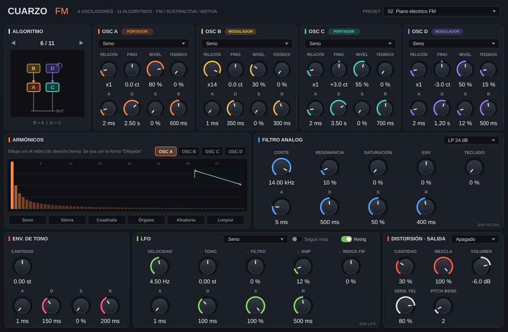

# Cuarzo FM — Sintetizador VST3

Sintetizador polifónico (16 voces) que combina **síntesis FM**, **sustractiva** y **aditiva**, escrito en C++ con JUCE 8.



## Características

| Sección | Detalle |
|---|---|
| **4 osciladores (A–D)** | Cada uno puede ser portador o modulador según el algoritmo. Relación de frecuencia (x0.25 … x16), afinación fina (±100 cents), nivel / índice de modulación y feedback propio. |
| **11 algoritmos** | Desde la cadena completa `D > C > B > A` hasta `A \| B \| C \| D` en paralelo (síntesis sustractiva tradicional). Clic / rueda sobre el diagrama para cambiar. |
| **Formas de onda** | Seno, triángulo, cuadrada, diente de sierra, ruido blanco y **dibujada** (64 armónicos por oscilador). Todas las tablas están limitadas en banda (mipmaps) para reducir el aliasing. |
| **7 envolventes ADSR** | Una por oscilador (4), filtro, LFO (profundidad) y tono. Ataque convexo y caídas exponenciales de estilo analógico. |
| **Filtro analógico modelado** | Ladder de 4 polos (topología zero-delay feedback) con saturación tanh dentro del lazo. Modos LP24, LP12, BP12, HP12, HP24 y Notch. Resonancia auto-oscilante, saturación, cantidad de envolvente y seguimiento de teclado. |
| **Distorsión** | Overdrive (asimétrico), saturación tipo cinta, fuzz, wavefolder y bitcrusher, con mezcla dry/wet. |
| **LFO** | Seno, triángulo, sierra, cuadrada y S&H. De 0.01 Hz a **2 kHz** (velocidad de audio) y modo *Seguir nota* para FM/AM armónica. Destinos: tono, filtro, amplitud e índice FM. |
| **Extras** | 8 presets de fábrica, sensibilidad a velocidad, pitch bend configurable, rueda de modulación = vibrato, estado completo guardado con la sesión del DAW. |

### Los 11 algoritmos

| # | Enrutamiento | Portadores |
|---|---|---|
| 1 | D > C > B > A | A |
| 2 | (C + D) > B > A | A |
| 3 | (B + D>C) > A | A |
| 4 | D > (B, C) > A | A |
| 5 | (B + C + D) > A | A |
| 6 | B > A  \|  D > C | A, C |
| 7 | D > C > B  \|  A | A, B |
| 8 | D > (A, B, C) | A, B, C |
| 9 | D > C  \|  A  \|  B | A, B, C |
| 10 | (C + D) > A  \|  B | A, B |
| 11 | A \| B \| C \| D (paralelo) | todos |

En un **portador**, la perilla *Nivel* es el volumen de salida; en un **modulador**, es el índice de modulación (cuánto "brillo" FM aporta). La etiqueta PORTADOR / MODULADOR de cada oscilador se actualiza al cambiar de algoritmo.

## Obtener el VST3 sin instalar nada (GitHub Actions)

1. Crea un repositorio en GitHub y sube esta carpeta tal cual (incluye `.github/workflows/build.yml`).
2. Ve a la pestaña **Actions**: la compilación arranca sola (o pulsa *Run workflow*).
3. En ~10 minutos, abre la ejecución terminada y descarga en **Artifacts**:
   `CuarzoFM-VST3-Windows-x64`, `CuarzoFM-VST3-macOS-Universal` o `CuarzoFM-VST3-Linux-x64`.

En macOS, como el plugin no está firmado por un desarrollador de Apple, ejecuta una vez
`xattr -cr ~/Library/Audio/Plug-Ins/VST3/"Cuarzo FM.vst3"` si el DAW lo bloquea.

## Compilar

Necesitas **CMake 3.22+** y un compilador C++17. JUCE 8.0.9 se descarga automáticamente la primera vez (o usa una copia local con `-DJUCE_DIR=/ruta/a/JUCE`).

### Windows (Visual Studio 2022)
```bat
cmake -B build -G "Visual Studio 17 2022"
cmake --build build --config Release
```
Resultado: `build\CuarzoFM_artefacts\Release\VST3\Cuarzo FM.vst3` → cópialo a `C:\Program Files\Common Files\VST3\`.

### macOS (Xcode)
```bash
cmake -B build -G Xcode
cmake --build build --config Release
```
Resultado: `build/CuarzoFM_artefacts/Release/VST3/Cuarzo FM.vst3` → cópialo a `~/Library/Audio/Plug-Ins/VST3/`.

### Linux
```bash
sudo apt install build-essential cmake libasound2-dev libx11-dev libxrandr-dev libxinerama-dev \
                 libxcursor-dev libxcomposite-dev libxext-dev libfreetype6-dev libfontconfig1-dev
cmake -B build -DCMAKE_BUILD_TYPE=Release
cmake --build build -j
```
Resultado: `build/CuarzoFM_artefacts/Release/VST3/Cuarzo FM.vst3` → cópialo a `~/.vst3/`.

Además del VST3 se compila una **aplicación Standalone** para probar el sintetizador sin DAW. Para omitirla: `-DCUARZO_BUILD_STANDALONE=OFF`.

## Uso rápido

- **Diagrama de algoritmo:** clic en la mitad derecha (o rueda) = siguiente; clic izquierdo en el tercio izquierdo o clic derecho = anterior.
- **Armónicos:** elige la pestaña OSC A–D y dibuja las barras con el ratón (clic derecho borra). Al dibujar, ese oscilador cambia automáticamente a la forma *Dibujada*. Los botones aplican formas base (Seno, Sierra, Cuadrada, Órgano, Aleatoria, Limpiar).
- **Doble clic** en cualquier perilla la devuelve a su valor por defecto; clic en el valor permite escribirlo.
- **LFO a velocidad de audio:** activa *Seguir nota* y sube la velocidad; con VELOCIDAD = 261.6 Hz el LFO va a la frecuencia de la nota tocada (Do4 de referencia). Envíalo a → AMP para modulación en anillo o a → TONO para FM exponencial.

## Estructura del código

```
Source/
  Parameters.h          Definición de los ~100 parámetros automatizables
  PluginProcessor.*     Procesador de audio, estado, presets, tablas dibujadas (doble buffer)
  SynthVoice.*          Voz: 4 operadores FM, envolventes, LFO, filtro
  Presets.*             Presets de fábrica
  PluginEditor.*        Interfaz gráfica
  DSP/
    Wavetables.h        Tablas de onda limitadas en banda (mipmaps por octava)
    Envelope.h          ADSR de estilo analógico
    LadderFilter.h      Filtro ladder ZDF con saturación y 6 modos
    Algorithms.h        Los 11 algoritmos de enrutamiento
    Modulation.h        LFO, ruido y etapa de distorsión
  UI/                   LookAndFeel, perillas, diagrama de algoritmo, editor de armónicos
```

## Verificación realizada

El VST3 se compiló en Linux (GCC 13, sin advertencias) y se cargó en un host VST3 de pruebas: los 8 presets producen audio válido (sin NaN ni clipping), el guardado/carga de estado es idéntico y 16 voces simultáneas usan ~10 % de un núcleo a 48 kHz.

## Licencia

El código de Cuarzo FM es tuyo para usar y modificar. **JUCE** tiene su propia licencia (AGPLv3 o licencia comercial de JUCE); revisa los términos en [juce.com](https://juce.com/get-juce/) antes de distribuir binarios. VST es una marca de Steinberg Media Technologies GmbH.
